# 🏗️ DIAGRAM ARSITEKTUR SISTEM — E-commerce AI Analyst
> **Tugas Akhir** | Stack: Streamlit + LangGraph + Google Gemini + scikit-learn
>
> **Panduan:** File ini berisi semua diagram dalam format Mermaid. Masukkan konten tiap blok ```mermaid ... ``` ke tool seperti Mermaid.live, draw.io, atau AI (ChatGPT/Claude) untuk generate flowchart-nya.

---

## DAFTAR ISI

1. [Arsitektur Sistem (System Architecture)](#1-arsitektur-sistem-berlapis-layer-architecture)
2. [Flowchart Alur Upload & Data Pipeline](#2-flowchart-alur-upload--data-pipeline)
3. [Flowchart Agentic AI — ReAct Loop](#3-flowchart-agentic-ai--react-loop)
4. [Flowchart Tool Routing (Tool Selection)](#4-flowchart-tool-routing--tool-selection)
5. [Flowchart Python REPL Sandbox](#5-flowchart-python-repl-sandbox--keamanan)
6. [Flowchart Forecasting (ML Prediction)](#6-flowchart-forecasting--rolling-forecast-ml)
7. [Flowchart Web Scraper Marketplace](#7-flowchart-web-scraper-marketplace)
8. [Use Case Diagram](#8-use-case-diagram)
9. [Business Process Flow (Alur Proses Bisnis)](#9-business-process-flow-alur-proses-bisnis)
10. [Entity Relationship & Data Flow Diagram](#10-entity-relationship--data-flow-diagram)
11. [Sequence Diagram — Skenario Lengkap](#11-sequence-diagram--skenario-lengkap)
12. [State Machine Diagram — Session State](#12-state-machine-diagram--session-state)
13. [Component Diagram](#13-component-diagram)
14. [Deployment Diagram](#14-deployment-diagram)

---

## 1. Arsitektur Sistem Berlapis (Layer Architecture)

> **Prompt ke AI:** "Buatkan diagram arsitektur berlapis (layered architecture) berdasarkan spesifikasi berikut"

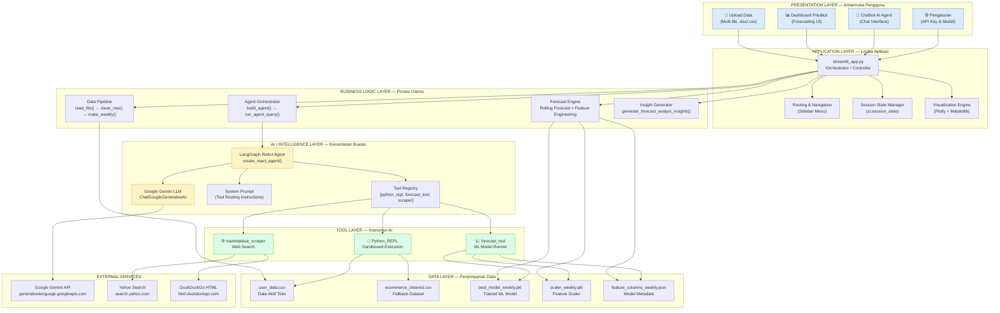

---

## 2. Flowchart Alur Upload & Data Pipeline

> **Prompt ke AI:** "Buatkan flowchart detail alur proses upload data dan data pipeline dari input file hingga penyimpanan"

```mermaid
flowchart TD
    START(["🚀 Pengguna Buka Halaman Upload Data"]) --> A

    A["📂 Pilih File\n(.xlsx / .xls / .csv)\nbisa multi-file"] --> B{File dipilih?}
    B -- Tidak --> WAIT(["⏳ Tunggu Input"])
    B -- Ya --> C

    C["🔍 read_file()\nDeteksi format file"] --> D{Format?}
    D -- ".xlsx / .xls" --> E["pd.read_excel()\nMembaca file Excel"]
    D -- ".csv" --> F["Coba encoding:\n1. utf-8\n2. latin-1\n3. cp1252"]
    F --> G{Berhasil?}
    G -- Ya --> H["pd.read_csv()"]
    G -- Tidak semua --> I["Fallback: utf-8\nerrors='replace'"]
    I --> H
    E --> J["DataFrame Mentah / Raw"]
    H --> J

    J --> K{Multi-file?}
    K -- Ya --> L["pd.concat()\nGabung semua DataFrame"]
    K -- Tidak --> M
    L --> M

    M["🧹 clean_raw()\nPembersihan Data"] --> M1
    M1["1. Normalisasi kolom tanggal"] --> M2
    M2["2. Bersihkan Total Pembayaran\nHapus titik, koma ke titik, to numeric"] --> M3
    M3["3. Filter Status: Hanya 'Selesai'"] --> M4
    M4["4. Filter Nilai: Hapus baris <= 0"] --> M5
    M5["5. Parse Tanggal ke datetime"] --> M6
    M6["6. reset_index(drop=True)"] --> N

    N["DataFrame Bersih / df_clean"] --> O

    O["📅 make_weekly()\nAgregasi Mingguan"] --> O1
    O1["Deduplikasi order_id\n1 order = 1 baris"] --> O2
    O2["Groupby order_date, freq='W'\nSum Total Pembayaran per minggu"] --> O3
    O3["Reindex full date range\nIsi gap minggu kosong = 0"] --> P

    P["weekly_hist: Time Series Omzet Mingguan"] --> Q

    N --> R["💾 Simpan ke Session State\nst.session_state['df_clean']\nst.session_state['weekly_hist']"]
    P --> R

    R --> S["💾 Export ke Disk\nuser_data.csv\n(Jembatan ke AI Agent)"]

    S --> T{Upload berhasil?}
    T -- Ya --> U["✅ Tampilkan Metrik Ringkasan\nTotal Transaksi, Revenue,\nJumlah Produk, Rentang Tanggal"]
    T -- Error --> V["❌ Tampilkan Pesan Error"]

    U --> W["📊 Tampilkan Visualisasi\nTren Revenue + Top 10 Produk"]
    W --> END(["✅ Data Siap Digunakan"])

    style START fill:#22c55e,color:#fff
    style END fill:#3b82f6,color:#fff
    style V fill:#ef4444,color:#fff
```

---

## 3. Flowchart Agentic AI — ReAct Loop

> **Prompt ke AI:** "Buatkan flowchart arsitektur ReAct (Reasoning + Acting) agent dengan loop iteratif"

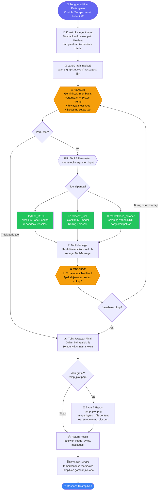

---

## 4. Flowchart Tool Routing & Tool Selection

> **Prompt ke AI:** "Buatkan flowchart decision tree untuk pemilihan tool berdasarkan intent pengguna dalam sistem AI agent"

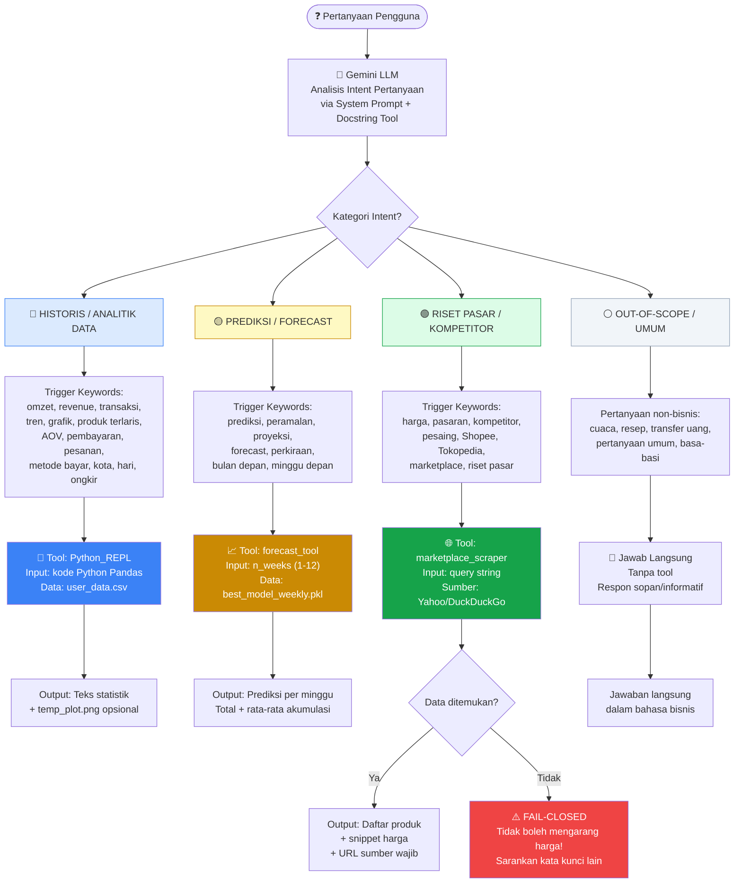

---

## 5. Flowchart Python REPL Sandbox & Keamanan

> **Prompt ke AI:** "Buatkan flowchart 3-layer security architecture untuk sandboxed Python code execution oleh AI agent"

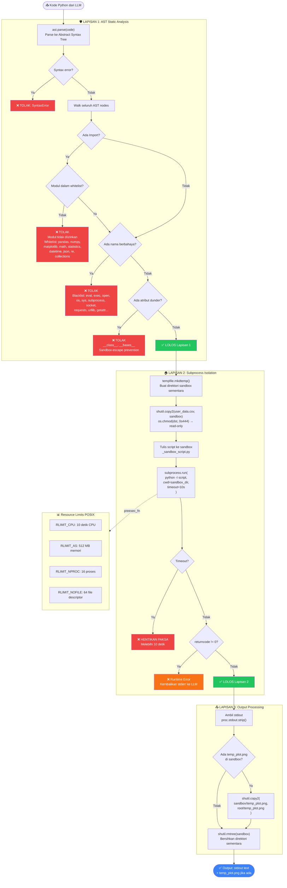

---

## 6. Flowchart Forecasting — Rolling Forecast ML

> **Prompt ke AI:** "Buatkan flowchart proses rolling forecast machine learning dengan feature engineering time series"

```mermaid
flowchart TD
    START(["📈 forecast_tool dipanggil\nn_weeks = 1 sampai 12"]) --> A

    A{File model tersedia?\nbest_model_weekly.pkl} -- Tidak --> FALLBACK["⚠️ Fallback Response\nEstimasi rata-rata Rp 15 jt/minggu"]
    A -- Ya --> B

    B["Load artifacts:\nbest_model_weekly.pkl → model\nscaler_weekly.pkl → StandardScaler\nfeature_columns_weekly.json → metadata"] --> C

    C["Load data historis\nuser_data.csv → groupby W → weekly_hist"] --> D

    D["last_dt = tanggal minggu terakhir\ndf_roll = salinan weekly_hist"] --> E

    E(["🔁 MULAI ROLLING LOOP\ni = 0 hingga n_weeks - 1"]) --> F

    F["future_dt = last_dt + (i+1) minggu\nTambah placeholder baris ke df_roll"] --> G

    subgraph FE["⚙️ FEATURE ENGINEERING per iterasi"]
        G["📅 Kalender: year, month,\nweek_of_year, quarter"] --> G1
        G1["〰️ Fourier: sin_month, cos_month,\nsin_year, cos_year"] --> G2
        G2["📉 Trend: week_index\n(hari dari 2023-12-31 / 7)"] --> G3
        G3["⏪ Lag Features:\nlag_1, lag_4, lag_12\n(dari history yang ada)"] --> G4
        G4["📊 Rolling Features:\nrolling_4w_mean, rolling_12w_mean"] --> G5
        G5["🌙 Kalender Islam:\nis_ramadan (hijri_converter)\nis_harbolnas (10-18 Desember)"] --> G6
        G6["🚩 is_holiday_gap = 0"]
    end

    G6 --> H["scaler.transform(X[scale_cols])\nNormalisasi fitur numerik"] --> J

    J["🔮 Prediksi:\ny_log = model.predict(X)\ny_idr = np.expm1(y_log)\n(inverse log1p transform)"] --> K

    K["Simpan:\norder_week = future_dt\npredicted_revenue = y_idr"] --> L

    L["Update df_roll:\nTambahkan baris prediksi\nagar iterasi berikut bisa pakai\nnilai ini sebagai lag"] --> M

    M{i < n_weeks - 1?} -- Ya, lanjut loop --> F
    M -- Selesai --> N

    N["Format output string:\nPrediksi per minggu\nTotal akumulasi\nRata-rata mingguan"] --> END(["✅ Return string prediksi ke LLM"])

    style START fill:#6366f1,color:#fff
    style FALLBACK fill:#f59e0b,color:#000
    style END fill:#22c55e,color:#fff
```

---

## 7. Flowchart Web Scraper Marketplace

> **Prompt ke AI:** "Buatkan flowchart web scraping dengan dual-path strategy dan fail-closed safety mechanism untuk keamanan data"

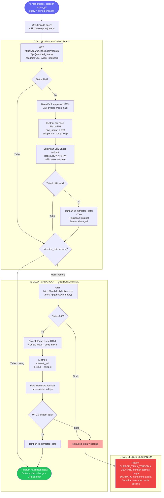

---

## 8. Use Case Diagram

> **Prompt ke AI:** "Buatkan use case diagram UML lengkap dengan semua aktor, use case, dan relasi include/extend untuk sistem AI Analyst E-commerce"

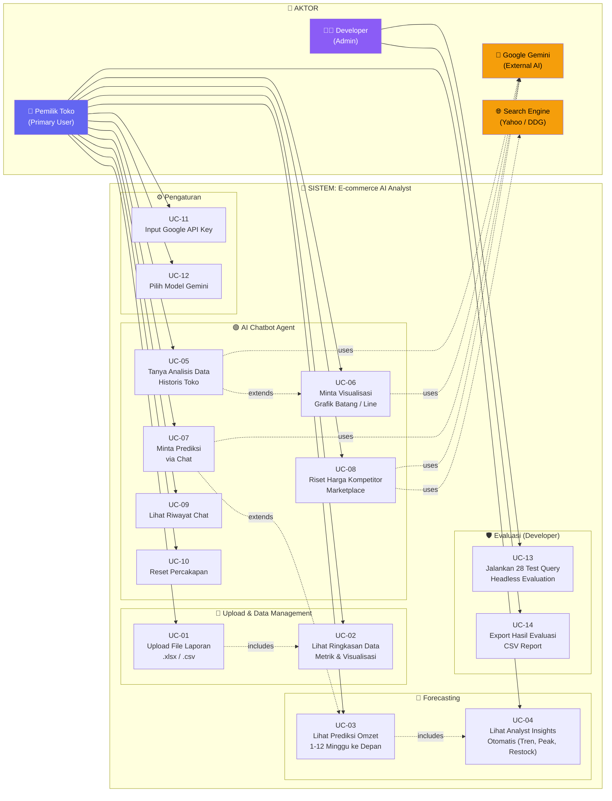

---

## 9. Business Process Flow (Alur Proses Bisnis)

> **Prompt ke AI:** "Buatkan BPMN-style business process diagram alur lengkap penggunaan sistem dari perspektif pemilik toko UMKM"

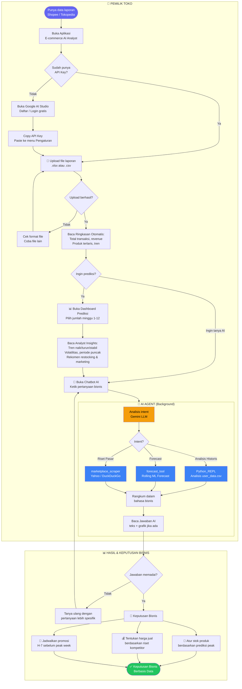

---

## 10. Entity Relationship & Data Flow Diagram

> **Prompt ke AI:** "Buatkan DFD (Data Flow Diagram) level 1 yang menampilkan seluruh aliran data, proses, dan penyimpanan dalam sistem"

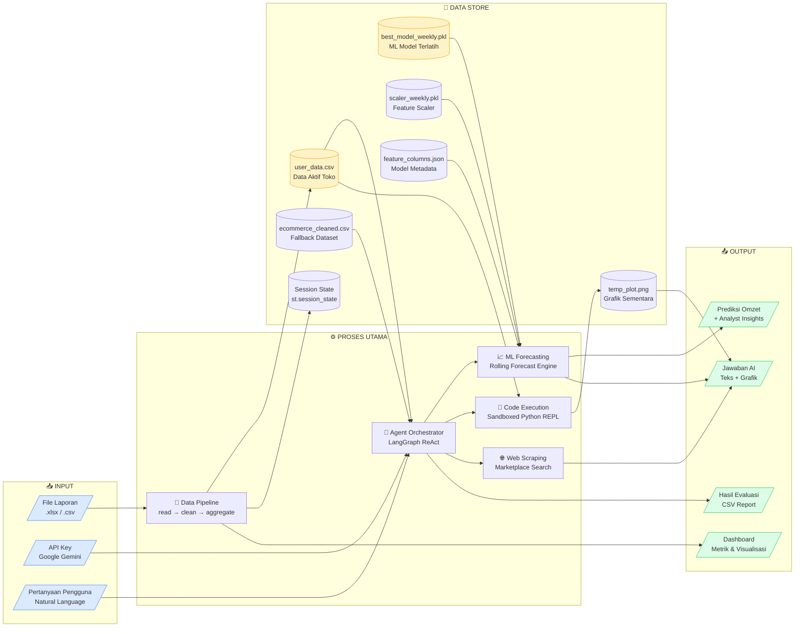

---

## 11. Sequence Diagram — Skenario Lengkap

### 11A. Skenario: Tanya Analisis Data (Python REPL)

> **Prompt ke AI:** "Buatkan sequence diagram interaksi antara user, Streamlit, LangGraph, Gemini LLM, dan Python REPL sandbox"

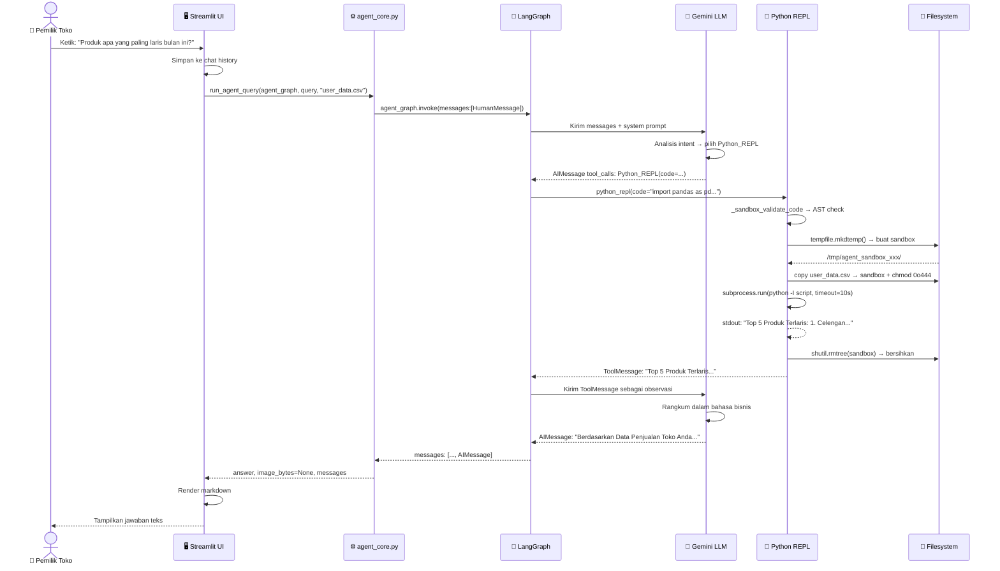

### 11B. Skenario: Minta Grafik + Prediksi (Multi-Tool)

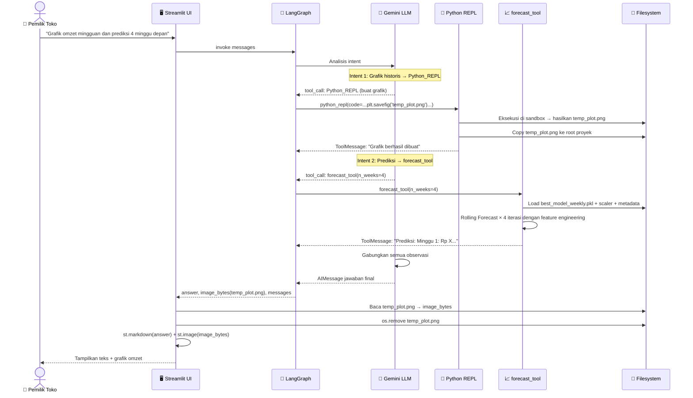

---

## 12. State Machine Diagram — Session State

> **Prompt ke AI:** "Buatkan state machine diagram manajemen state aplikasi Streamlit multi-halaman dengan session state"

```mermaid
stateDiagram-v2
    [*] --> INIT : App dibuka

    state INIT {
        [*] --> CheckAPIKey
        CheckAPIKey --> NoAPIKey : Belum ada API Key
        CheckAPIKey --> HasAPIKey : API Key tersedia
    }

    INIT --> ONBOARDING : First visit / no data

    state ONBOARDING {
        [*] --> ShowWelcome
        ShowWelcome --> ShowFeatures
        ShowFeatures --> PromptUpload
    }

    ONBOARDING --> UPLOAD_PAGE : User klik mulai

    state UPLOAD_PAGE {
        [*] --> WaitingFile
        WaitingFile --> Processing : File dipilih
        Processing --> DataReady : Berhasil clean
        Processing --> ErrorState : Gagal parse
        ErrorState --> WaitingFile : User coba lagi
    }

    DataReady --> DATA_READY : Upload sukses

    state DATA_READY {
        note right of DATA_READY
            st.session_state:
            df_clean = DataFrame bersih
            weekly_hist = Time Series
            user_data.csv = ditulis ke disk
        end note
    }

    DATA_READY --> DASHBOARD_PAGE : Klik Dashboard
    DATA_READY --> CHATBOT_PAGE : Klik Chatbot
    DATA_READY --> UPLOAD_PAGE : Upload data baru

    state DASHBOARD_PAGE {
        [*] --> RunForecast
        RunForecast --> ForecastDone : Model tersedia
        RunForecast --> FallbackMode : Model tidak ada
        ForecastDone --> ShowInsights
        ShowInsights --> ShowCharts
    }

    state CHATBOT_PAGE {
        [*] --> WaitingQuery
        WaitingQuery --> Processing : User kirim pesan
        Processing --> ToolExec : LLM pilih tool
        ToolExec --> WaitingLLM : Tool selesai
        WaitingLLM --> ShowResponse : LLM jawaban final
        ShowResponse --> WaitingQuery : Siap query berikut
        ShowResponse --> Cleared : User klik reset
        Cleared --> WaitingQuery
    }

    DASHBOARD_PAGE --> DATA_READY : Kembali
    CHATBOT_PAGE --> DATA_READY : Kembali

    state SETTINGS_PAGE {
        [*] --> EnterAPIKey
        EnterAPIKey --> ValidateKey : Submit
        ValidateKey --> KeyValid : Valid
        ValidateKey --> KeyInvalid : Invalid
        KeyInvalid --> EnterAPIKey
    }

    DATA_READY --> SETTINGS_PAGE : Klik Pengaturan
    INIT --> SETTINGS_PAGE : Klik Pengaturan
    SETTINGS_PAGE --> INIT : Simpan
```

---

## 13. Component Diagram

> **Prompt ke AI:** "Buatkan component diagram UML yang menampilkan dependencies dan interface antar komponen sistem"

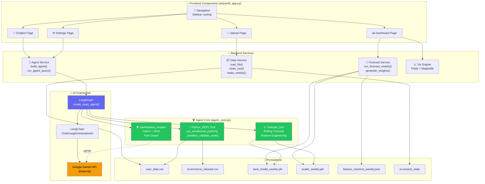

---

## 14. Deployment Diagram

> **Prompt ke AI:** "Buatkan deployment diagram yang menampilkan deployment lokal dan cloud dari aplikasi Streamlit dengan semua dependencies eksternal"

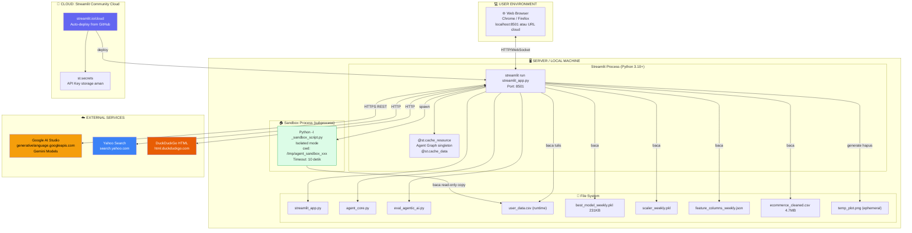

---

## 📋 RINGKASAN NARASI SISTEM

### Alur Utama Lengkap

```
[PEMILIK TOKO]
     │
     ▼ (1) Buka aplikasi → Input API Key → Upload file Shopee/Tokopedia
     │
[DATA PIPELINE]
     │ read_file() → clean_raw() → make_weekly() → user_data.csv
     │
     ├──► (2) DASHBOARD UI
     │         Tampilkan metrik, grafik tren, top produk terlaris
     │
     ├──► (3) FORECASTING ML
     │         Rolling Forecast → Analyst Insights:
     │         • Tren (naik/turun/stabil)
     │         • Deteksi periode puncak (Ramadan, Harbolnas)
     │         • Rekomendasi restocking & jadwal marketing
     │
     └──► (4) CHATBOT AI AGENT (LangGraph ReAct)
               │
               ├── Tanya analisis historis
               │     → Python_REPL (sandbox 3-layer) → Pandas → Grafik opsional
               │
               ├── Tanya prediksi
               │     → forecast_tool → Rolling ML Forecast (1-12 minggu)
               │
               └── Tanya harga kompetitor
                     → marketplace_scraper → Yahoo/DDG → URL wajib disertakan
                     → FAIL-CLOSED jika kosong (DILARANG mengarang harga!)
```

### Keamanan Python REPL — 3 Lapis Perlindungan

```
Kode Python dari LLM
     │
     ▼ [Lapisan 1] AST Static Analysis
     │  Whitelist modul: pandas, numpy, matplotlib, math, statistics, datetime, json, re
     │  Blacklist builtin: os, sys, subprocess, requests, eval, exec, open, __import__
     │  Blokir atribut dunder: sandbox-escape prevention
     │
     ▼ [Lapisan 2] Subprocess Isolation
     │  python -I (isolated mode, abaikan PYTHONPATH)
     │  cwd = direktori sandbox sementara di /tmp/
     │  Timeout 10 detik wall-clock
     │  Resource limits POSIX: CPU 10s, RAM 512MB, 16 proses, 64 file descriptor
     │
     ▼ [Lapisan 3] Read-Only Dataset
        user_data.csv disalin ke sandbox, chmod 0o444 (read-only)
        Data toko asli tidak dapat dimodifikasi oleh kode LLM
```

---

## 💡 PANDUAN PENGGUNAAN FILE INI

| Platform | Cara Pakai |
|----------|------------|
| **Mermaid.live** | Copy isi `````mermaid ... ````` → Paste ke [mermaid.live](https://mermaid.live) |
| **GitHub / GitLab** | Push file ini → Mermaid otomatis ter-render di README |
| **draw.io** | Import → From text → Pilih Mermaid |
| **VS Code** | Install ekstensi "Markdown Preview Mermaid Support" |
| **ChatGPT / Claude** | Copy section + prompt: *"Buatkan flowchart visual dari deskripsi ini"* |
| **Eraser.io** | Paste Mermaid → Auto render + bisa edit secara visual |
| **Lucidchart** | Import Mermaid diagram → Customize layout |
